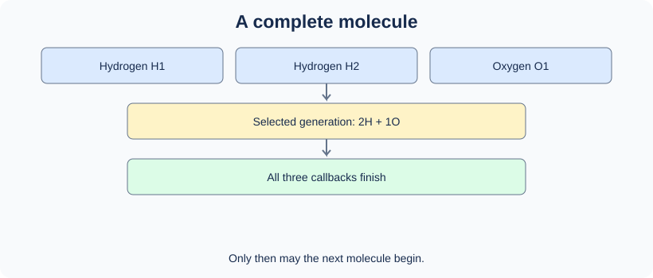
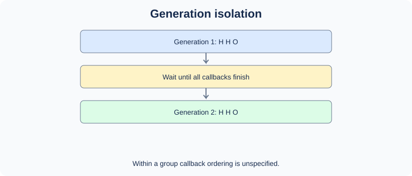

# Problem 11/45 — Concurrent H2O Formation

**Difficulty:** Hard | **Language:** Java 21 | **Target:** 30–40 minutes

## Problem statement

Hydrogen and oxygen threads arrive concurrently. Coordinate them into disjoint groups of exactly two hydrogen threads and one oxygen thread. No member of the next molecule may invoke its release callback until all three callbacks of the current molecule have finished.



## API contract

```java
interface MoleculeBuilder {
    void hydrogen(Runnable releaseHydrogen) throws InterruptedException;
    void oxygen(Runnable releaseOxygen) throws InterruptedException;
}
```

Each accepted participant invokes its callback exactly once. The callback order within a molecule is unspecified. Select two H and one O before allowing callbacks to begin; incomplete groups wait without busy spinning. Assume non-null callbacks complete normally for the basic version. Define cancellation explicitly: an interrupted unselected waiter leaves without consuming a slot; after selection, finish the committed group or abort it using a clearly documented group-wide failure policy. Do not leave peers stuck.

## Example input and expected behaviour

Input arrival sequence: O,H,H,H,O,H. Valid output: OHHHOH or HHOHHO. Invalid output: HHHOOH, because the first three callbacks contain no oxygen. Six participants form two molecules.



## Starter code

```java
class H2O implements MoleculeBuilder {
    private final ReentrantLock lock = new ReentrantLock();
    private final Condition changed = lock.newCondition();
    // TODO: waiting hydrogen/oxygen counts or queues,
    // generation state and completion tracking.
}
```

Import the necessary Java collections, concurrency classes and locks. Starter code is intentionally incomplete.

## Implementation hints

1. Separate waiting participants from selected participants.
2. Select a complete 2H+1O group atomically.
3. Use generation identity or a barrier to isolate one molecule from the next.
4. Track completion of all three callbacks before admitting a new group.
5. Avoid invoking arbitrary callbacks under the bookkeeping lock.
6. Handle interruption before selection without leaking reservations.

## Invariants

- Every selected generation contains exactly two H and one O.
- A participant belongs to at most one generation.
- Callbacks from successive generations never overlap.
- Cancellation cannot strand an incomplete generation.

## Constraints

- Implement the target component yourself; do not delegate to an equivalent library implementation.
- No busy waiting or sleep-based synchronization.
- Protect shared mutable state, handle spurious wakeups where applicable, and release acquired locks in finally blocks.
- Do not assume OS thread execution order.
- Account for elapsed time with a monotonic clock when implementing timed acquisition.

## Test scenarios

- Random arrival order with equal molecule counts.
- Excess hydrogen waits until oxygen arrives.
- Excess oxygen waits until two hydrogen threads arrive.
- Each consecutive group of three outputs has two H and one O.
- Verify slow callback prevents the next generation from starting.
- Interrupt an unselected waiter and confirm later groups still form.

## Advanced challenge

Generalize to arbitrary stoichiometry, such as NH3 (1 N + 3 H), using configurable participant counts and explicit failure handling for callbacks.

No solution code is supplied.
