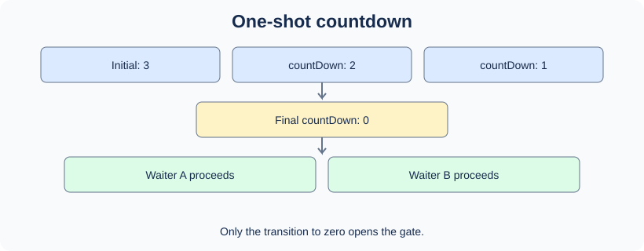
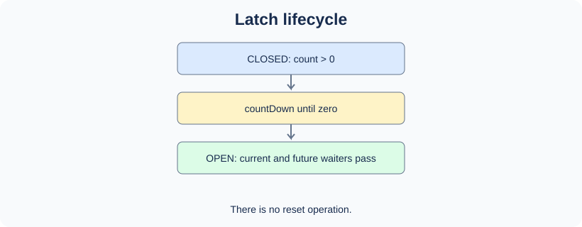

# Problem 6/45 — CountDown Latch

**Difficulty:** Hard | **Language:** Java 21 | **Target:** 25–35 minutes

## Problem statement

Implement a one-shot synchronization gate. Any number of threads can wait for a fixed number of events to complete. Once the counter reaches zero, all present and future waiters may proceed.



## API contract

```java
interface Latch {
    void await() throws InterruptedException;
    boolean await(long timeout, TimeUnit unit) throws InterruptedException;
    void countDown();
    long getCount();
}
```

Initial count must be nonnegative. await() blocks interruptibly while count is positive. Timed await returns true when open, false on timeout. countDown() decrements only if positive, never blocks for completion, and wakes all waiters on the transition to zero. Count cannot be reset. An interrupted waiter does not change the count or cancel other waiters.

## Example input and expected behaviour

Initial count = 3. W1 and W2 call await(). Worker A counts down to 2, B to 1, C to 0. Both waiters may proceed; a later W3 passes immediately.



## Starter code

```java
class MyCountDownLatch implements Latch {
    private final ReentrantLock lock = new ReentrantLock();
    private final Condition opened = lock.newCondition();
    private long count;
    // TODO: constructor and methods.
}
```

Import the required Java collections, concurrency utilities and locks. Starter code is intentionally incomplete.

## Implementation hints

1. Protect count with the internal lock.
2. Use a while predicate for await; release all waiters only on transition to zero.
3. Keep countDown idempotent once count is zero.
4. Account for timed lock acquisition and condition waiting.
5. Decide how to publish writes made by workers before countDown to successful waiters.

## Invariants

- count >= 0 and never increases.
- Once opened, the gate remains open.
- A successful await observes an open latch.

## Constraints

- Implement the target component yourself; do not delegate to its equivalent JDK implementation.
- No busy waiting or sleep-based synchronization.
- Protect shared mutable state, handle spurious wakeups, and release locks in finally blocks.
- Define interruption and timeout behaviour explicitly; timed waits account for lock acquisition where applicable, but scheduling can delay return.
- Do not assume a particular OS thread execution order.

## Test scenarios

- Zero initial count returns immediately.
- Negative initial count rejected.
- Multiple waiters released only at zero.
- Extra countDown calls do not underflow.
- Timeout and interrupted waiter do not modify count.
- Verify worker-written results are visible after await.

## Advanced challenge

Implement a second version using AbstractQueuedSynchronizer shared mode, and compare it with the lock/condition design.

No solution code is supplied.
