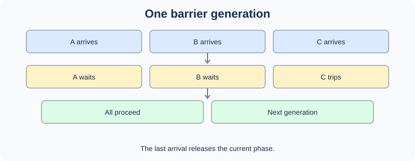
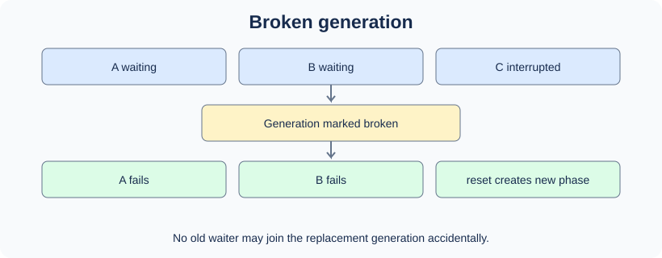

# Problem 5/45 — Cyclic Barrier

**Difficulty:** Hard | **Language:** Java 21 | **Target:** 30–40 minutes

## Problem statement

Coordinate N threads through repeated phases. No participant may proceed past the barrier until all N participants have arrived in the same generation.



## API contract

```java
interface Barrier {
    int await() throws InterruptedException, BrokenBarrierException;
    int await(long timeout, TimeUnit unit)
        throws InterruptedException, BrokenBarrierException, TimeoutException;
    void reset();
    boolean isBroken();
    int getNumberWaiting();
}
```

Return an arrival index from N-1 (first arrival) to 0 (last arrival). The last arrival executes an optional barrier action exactly once before releasing the generation. An interrupted or timed-out waiter breaks its current generation: other waiters receive BrokenBarrierException. A failing barrier action also breaks the generation. reset() breaks the old generation and installs a fresh one. Interruption after successful generation advance must not break the next generation.

## Example input and expected behaviour

N = 3. A arrives (index 2), B arrives (index 1), C arrives (index 0). All three may proceed only after C arrives and the barrier action finishes. Repeat for the next phase; return order is not guaranteed.



## Starter code

```java
class MyCyclicBarrier implements Barrier {
    private final int parties;
    private final Runnable action;
    private final ReentrantLock lock = new ReentrantLock();
    private final Condition trip = lock.newCondition();
    // TODO: generation object, remaining arrivals, constructor and methods.
}
```

Import the required Java collections, concurrency utilities and locks. Starter code is intentionally incomplete.

## Implementation hints

1. Track a distinct generation object with its own broken flag.
2. Decrement remaining arrivals under the lock; the final arrival trips the barrier.
3. Wait on generation identity and broken status, not just the arrival count.
4. Reset arrival count when installing a new generation.
5. On timeout or interruption, distinguish a still-active generation from one that already advanced.
6. Define how barrier action failure and reset wake every old waiter.

## Invariants

- 0 <= remaining <= parties; each arrival belongs to exactly one generation.
- Only the final arrival runs the action for a successful generation.
- A broken generation cannot accidentally release callers as successful.

## Constraints

- Implement the target component yourself; do not delegate to its equivalent JDK implementation.
- No busy waiting or sleep-based synchronization.
- Protect shared mutable state, handle spurious wakeups, and release locks in finally blocks.
- Define interruption and timeout behaviour explicitly; timed waits account for lock acquisition where applicable, but scheduling can delay return.
- Do not assume a particular OS thread execution order.

## Test scenarios

- Three participants cannot proceed before the last arrives.
- Reuse for 100 generations.
- Action runs exactly once per successful generation.
- Interrupt and timeout break the barrier and wake peers.
- Reset during an active generation; new callers use the new generation.
- Action throws; all peers observe failure.

## Advanced challenge

Add a Phaser-like extension with dynamic registration and deregistration at phase boundaries.

No solution code is supplied.
