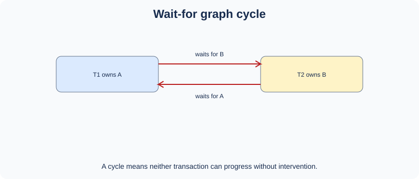
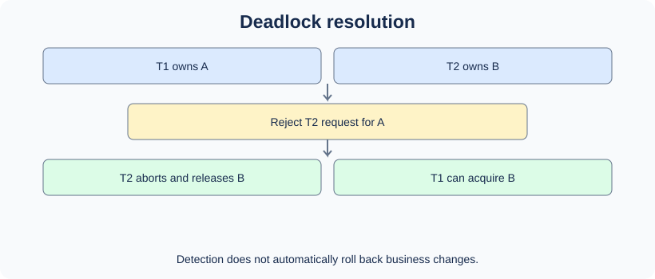

# Problem 13/45 — Deadlock Detecting Lock Manager

**Difficulty:** Very Hard | **Language:** Java 21 | **Target:** 60–75 minutes

## Problem statement

Build an in-memory exclusive resource lock manager for logical transactions. Transactions may acquire multiple resource locks in arbitrary order. Detect a cycle in the wait-for graph before admitting a request that would create a deadlock.



## API contract

```java
interface LockManager {
    void acquire(String transactionId, String resourceId)
        throws InterruptedException, DeadlockDetectedException;
    boolean tryAcquire(String transactionId, String resourceId,
                       long timeout, TimeUnit unit)
        throws InterruptedException, DeadlockDetectedException;
    void release(String transactionId, String resourceId);
    void releaseAll(String transactionId);
}
```

Each resource has at most one logical owner. Define repeated acquire by the same transaction as idempotent. Assume at most one outstanding acquisition per transaction; transaction IDs are not necessarily thread IDs. Reject an acquisition that creates a wait-for cycle, remove its request and report DeadlockDetectedException. The caller must abort or release its previously held resources; detection alone does not roll back transactions. Timeout/interruption removes the waiting request. releaseAll cancels outstanding requests for that transaction and releases all its locks; define a cancellation exception for affected callers. Non-owner release is rejected.

## Example input and expected behaviour

T1 owns A, T2 owns B. T1 requests B: edge T1 -> T2. T2 requests A: edge T2 -> T1 creates a cycle. Reject T2's request; after T2 aborts and releases B, T1 may acquire B.



## Starter code

```java
class DeadlockDetectingLockManager implements LockManager {
    private final ReentrantLock lock = new ReentrantLock();
    private final Condition changed = lock.newCondition();
    private final Map<String, String> owners = new HashMap<>();
    private final Map<String, String> waitingFor = new HashMap<>();
    // TODO: transaction ownership index, cancellation,
    // graph cycle detection and API methods.
}
```

Import the necessary Java collections, concurrency classes and locks. Starter code is intentionally incomplete.

## Implementation hints

1. Maintain resource ownership and each transaction's outstanding requested resource under one lock.
2. Derive wait-for edges from current resource ownership, rather than leaving stale edges after ownership changes.
3. Tentatively register a waiting request and run DFS or follow owner dependencies to detect a cycle.
4. Recheck eligibility and cycle safety on wakeup and before granting ownership; ownership changes may redirect existing wait edges.
5. Remove pending requests on all exceptional exits, timeout and cancellation.
6. Wake affected waiters after release or releaseAll.
7. Keep rollback/business callbacks outside the bookkeeping lock.

## Invariants

- A resource never has two owners.
- Waiting requests refer to live acquisition attempts.
- The wait-for graph reflects current owners; resolve or reject any cycle before permitting indefinite waiting.
- Rejected requests never silently release previously owned resources.

## Constraints

- Implement the target component yourself; do not delegate to an equivalent library implementation.
- No busy waiting or sleep-based synchronization.
- Protect shared mutable state, handle spurious wakeups where applicable, and release acquired locks in finally blocks.
- Do not assume OS thread execution order.
- Account for elapsed time with a monotonic clock when implementing timed acquisition.

## Test scenarios

- Uncontended acquisition and release.
- Two transactions competing for one resource.
- Two-node and three-node deadlock cycles.
- Acyclic dependency chain waits normally.
- Timeout/interruption removes graph edges.
- releaseAll wakes waiters and cancels pending acquisition.
- Concurrent ownership changes do not leave stale dependencies.

## Advanced challenge

Support shared/exclusive modes, multiple blockers per request, deterministic victim selection, transaction rollback integration and graph scalability. Discuss prevention vs detection.

No solution code is supplied.
