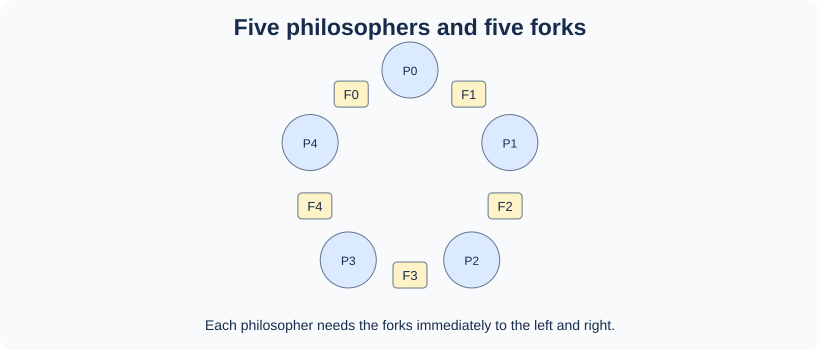
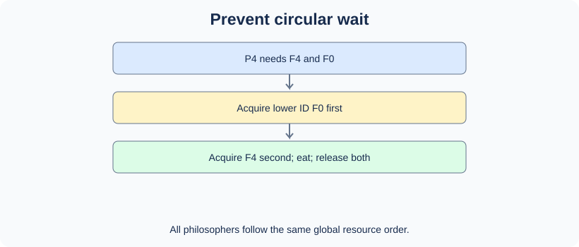

# Problem 10/45 — Dining Philosophers

**Difficulty:** Hard | **Language:** Java 21 | **Target:** 30–40 minutes

## Problem statement

Five philosophers sit around a circular table. Each alternates between thinking and eating. To eat, philosopher i must hold both adjacent forks, i and (i+1)%N. Implement coordination for arbitrary N >= 2 without deadlock.



## API contract

```java
interface DiningTable {
    void eat(int philosopherId, Runnable eatingAction)
        throws InterruptedException;
}
```

Validate IDs and non-null actions. Acquire both forks before invoking the action, never let adjacent philosophers eat simultaneously, and release every acquired fork even if interrupted during acquisition or if the action throws. Non-adjacent philosophers should be able to eat concurrently. Assume actions terminate and do not recursively acquire forks.

## Example input and expected behaviour

N=5: P0 holds F0 and F1, P2 holds F2 and F3; both may eat. P1 needs F1 and F2 and must wait. P4 needs F4 and F0 and must wait. When P0 releases, eligibility changes; no specific scheduling order is required in the basic version.



## Starter code

```java
class DiningTableImpl implements DiningTable {
    private final ReentrantLock[] forks;
    // TODO: constructor, acquisition order, cleanup and eat().
}
```

Import the necessary Java collections, concurrency classes and locks. Starter code is intentionally incomplete.

## Implementation hints

1. Represent each fork by a lock.
2. Map philosopher i to forks i and (i+1)%N.
3. Consider a global ordering of fork IDs to eliminate circular wait.
4. Use interruptible acquisition; if acquiring the second fork fails, release the first.
5. Run the eating callback only while both forks are held; use nested try/finally.
6. Compare with a semaphore-based approach that admits at most N-1 contenders.

## Invariants

- Each fork has at most one owner.
- Every eating philosopher owns both adjacent forks.
- Every successful fork acquisition has a matching release.
- The acquisition order contains no circular dependency.

## Constraints

- Implement the target component yourself; do not delegate to an equivalent library implementation.
- No busy waiting or sleep-based synchronization.
- Protect shared mutable state, handle spurious wakeups where applicable, and release acquired locks in finally blocks.
- Do not assume OS thread execution order.
- Account for elapsed time with a monotonic clock when implementing timed acquisition.

## Test scenarios

- Adjacent philosophers never overlap in their eating actions.
- Non-adjacent philosophers can overlap.
- Repeated rounds finish within a bounded test deadline.
- Interrupt a philosopher waiting for its second fork; first fork becomes available.
- Throw from the eating action and verify both forks are released.
- Test N=2 and N=5.

## Advanced challenge

Guarantee starvation freedom using an explicit waiter/admission queue. Discuss the concurrency trade-off of strict FIFO admission and why deadlock freedom alone does not guarantee fairness.

No solution code is supplied.
