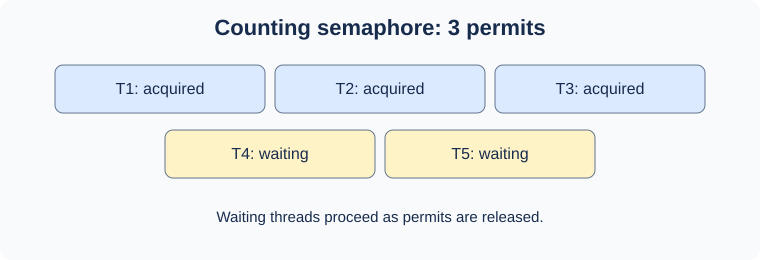
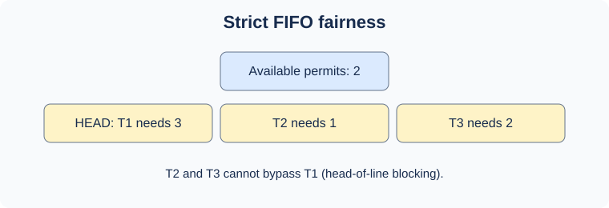

# Problem 3/45 — Fair Counting Semaphore

**Difficulty:** Hard | **Language:** Java 21 | **Target:** 30–40 minutes

## Problem statement

Implement a thread-safe counting semaphore from scratch. A semaphore limits simultaneous access to a resource. With three database connection permits and ten competing threads, at most three may hold permits simultaneously.



## API contract

```java
interface CountingSemaphore {
    void acquire() throws InterruptedException;
    void release();
    boolean tryAcquire();
    boolean tryAcquire(long timeout, TimeUnit unit)
        throws InterruptedException;
    int availablePermits();
}
```

| Method | Expected behaviour |
| --- | --- |
| acquire | Acquire one permit or block interruptibly. |
| release | Return one permit and notify eligible waiters. |
| tryAcquire | Attempt immediately without bypassing queued waiters. |
| Timed tryAcquire | Wait within the timeout budget, including lock acquisition. |
| availablePermits | Return the current count safely. |

Use a fixed positive maximum, initially all permits available. Reject over-release. Java's standard Semaphore does not automatically enforce a fixed maximum. Permits need not be released by the acquiring thread.

## Example (capacity = 2)

| Step | Operation | Available | FIFO waiters |
| --- | --- | ---: | --- |
| 1 | T1 acquires | 1 | [] |
| 2 | T2 acquires | 0 | [] |
| 3 | T3 requests | 0 | [T3] |
| 4 | T4 requests | 0 | [T3, T4] |
| 5 | T5 requests | 0 | [T3, T4, T5] |
| 6 | T1 releases | 1 | [T3, T4, T5] |
| 7 | T3 acquires | 0 | [T4, T5] |
| 8 | T2 releases | 1 | [T4, T5] |
| 9 | T4 acquires | 0 | [T5] |

## Fairness

Acquire in FIFO registration order, not thread creation order. A newly arriving thread must not steal an available permit from an existing waiter (barging). This requirement also applies to immediate tryAcquire in this exercise.

## Starter code

```java
import java.util.ArrayDeque;
import java.util.Queue;
import java.util.concurrent.TimeUnit;
import java.util.concurrent.locks.Condition;
import java.util.concurrent.locks.ReentrantLock;

class FairSemaphore implements CountingSemaphore {
    private final int maxPermits;
    private int permits;
    private final ReentrantLock lock = new ReentrantLock();
    private final Condition available = lock.newCondition();
    private final Queue<Thread> waiters = new ArrayDeque<>();

    // TODO: constructor and API methods
}
```

## Hints and implementation steps

1. Protect shared state with the same lock.
2. Register waiting threads in a FIFO queue.
3. Acquire only when a permit is available and the caller is at the head of the queue (or no waiters exist).
4. Decrement permits and remove the successful waiter atomically.
5. Release increments permits and notifies eligible waiters.
6. Remove interrupted or timed-out waiters and ensure the next waiter can progress.
7. Prevent immediate acquisition from bypassing existing waiters.
8. Consider whether signal() is sufficient with a shared condition, or whether signalAll() or per-waiter conditions are needed.

Thinking exercise: T3, T4 and T5 are waiting. T3 gets interrupted. How do you safely remove T3 and ensure T4 can progress?

## Constraints

- No built-in Semaphore or AbstractQueuedSynchronizer.
- No busy waiting or sleep-based synchronization.
- No permit leaks, over-release or barging.
- Maintain 0 <= permits <= maxPermits.
- Support concurrent callers, spurious wakeups and interruption.
- Account for elapsed timeout using System.nanoTime().
- Progress assumes eventual scheduling and release by permit holders.

## Advanced challenge: multiple permits

```java
void acquire(int permits) throws InterruptedException;
void release(int permits);
boolean tryAcquire(int permits, long timeout, TimeUnit unit)
    throws InterruptedException;
```

Acquire requested permits atomically and validate requests against maximum capacity.



With two free permits, T1 requests three, T2 requests one and T3 requests two. Under strict FIFO, neither T2 nor T3 can bypass T1. Explain the resulting throughput trade-off.

## Test scenarios

- Exhaust permits and verify subsequent acquisition blocks.
- Release a permit and verify the oldest registered waiter proceeds.
- Verify immediate acquisition cannot barge.
- Interrupt the head waiter and verify the next waiter progresses.
- Verify timeout removes a waiter without leaking permits.
- Reject over-release.
- Stress with concurrent callers and verify maximum simultaneous permit holders.

Implement the basic operations first, followed by fairness, timed acquisition, interruption cleanup and the multiple-permit extension.
