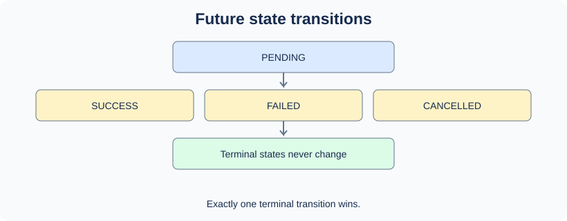
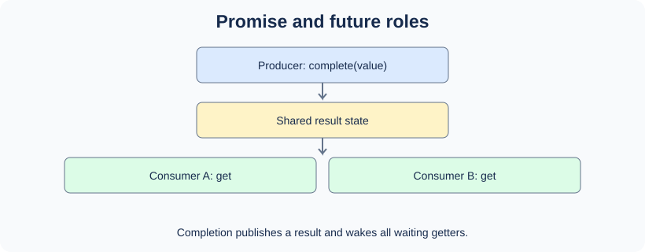

# Problem 8/45 — Future and Promise

**Difficulty:** Very Hard | **Language:** Java 21 | **Target:** 45–60 minutes

## Problem statement

Implement a one-shot asynchronous result abstraction. A promise is the producer-side completion handle; a future is the consumer-side handle used to await results or request cancellation.



## API contract

```java
interface MyFuture<T> {
    T get() throws InterruptedException, ExecutionException;
    T get(long timeout, TimeUnit unit)
        throws InterruptedException, ExecutionException, TimeoutException;
    boolean cancel(boolean mayInterruptIfRunning);
    boolean isDone();
    boolean isCancelled();
}
interface MyPromise<T> {
    MyFuture<T> future();
    boolean complete(T value);
    boolean completeExceptionally(Throwable failure);
}
```

Exactly one terminal transition wins: success, failure or cancellation. get returns the successful value (including null), wraps failures in ExecutionException, and throws CancellationException for cancellation. Timeout or interruption of a getter does not cancel the result. For the basic standalone promise, cancellation changes result state only; it has no runner to interrupt. In the task-backed extension, track runner ownership and implement cancel(true) as a cooperative interrupt request.

## Example input and expected behaviour

Two callers wait on get(). Producer completes with 42; both return 42. A subsequent completeExceptionally call returns false. If cancellation wins instead, both getters throw CancellationException.



## Starter code

```java
class PromiseImpl<T> implements MyPromise<T> {
    enum State { PENDING, SUCCESS, FAILED, CANCELLED }
    private final ReentrantLock lock = new ReentrantLock();
    private final Condition completed = lock.newCondition();
    private State state = State.PENDING;
    private T result;
    private Throwable failure;
    // TODO: future view and completion methods.
}
```

Import the required Java collections, concurrency utilities and locks. Starter code is intentionally incomplete.

## Implementation hints

1. Separate producer and consumer APIs over the same shared state.
2. Use the state rather than null to distinguish pending and successful null.
3. Publish result or error before announcing terminal completion.
4. Use signalAll to wake every getter.
5. Make competing completion and cancellation attempts atomic.
6. In task-backed mode, reason about runner registration, completion and interrupt delivery races.

## Invariants

- Terminal states never change.
- Only one completion or cancellation attempt wins.
- Successful get observes the published result; failed get observes the stored exception.

## Constraints

- Implement the target component yourself; do not delegate to its equivalent JDK implementation.
- No busy waiting or sleep-based synchronization.
- Protect shared mutable state, handle spurious wakeups, and release locks in finally blocks.
- Define interruption and timeout behaviour explicitly; timed waits account for lock acquisition where applicable, but scheduling can delay return.
- Do not assume a particular OS thread execution order.

## Test scenarios

- Multiple waiting getters receive the same result.
- Successful null result.
- Failure is wrapped correctly.
- Timeout and interrupted getter leave promise pending.
- Concurrent completion and cancellation have exactly one winner.
- Repeated completion cannot overwrite a terminal result.

## Advanced challenge

Implement task-backed futures with RUNNING state and safe runner interruption, then thenApply, thenCompose and allOf; callbacks run outside internal locks.

No solution code is supplied.
