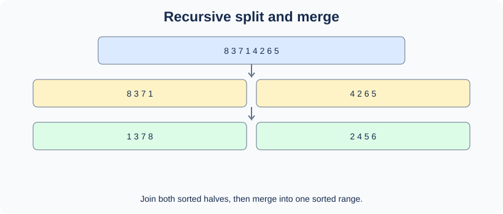
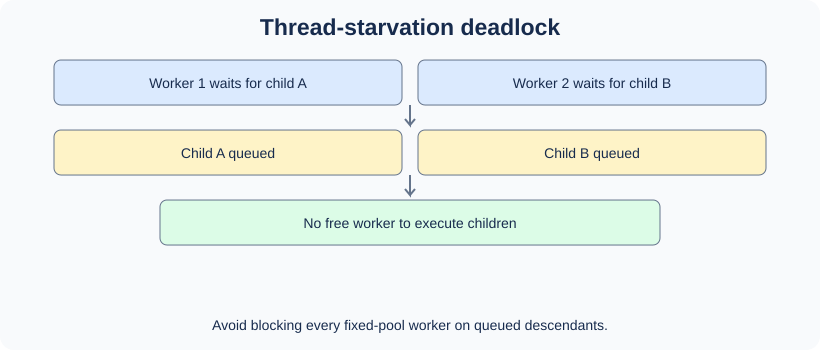

# Problem 12/45 — Multithreaded Merge Sort

**Difficulty:** Hard | **Language:** Java 21 | **Target:** 40–50 minutes

## Problem statement

Implement a parallel merge sort for a large integer array. Recursively split the array, sort disjoint ranges concurrently and merge them only after both child ranges are sorted. Use a configurable threshold to avoid excessive tiny tasks.



## API contract

```java
interface ParallelSorter {
    void sort(int[] values) throws InterruptedException;
}
```

Sort the input array in ascending order in place from the caller's perspective (an auxiliary buffer is allowed). Support empty arrays, duplicates and negative values. Do not return successfully until all sorting tasks have completed. Reject null input. Concurrent mutation of the same input by callers is unsupported. Define failure/interruption handling: do not claim successful completion on interruption; ensure outstanding tasks are joined or cancelled before callers may reuse the array.

## Example input and expected behaviour

Input: [8, 3, 7, 1, 4, 2, 6, 5]. Split into [8,3,7,1] and [4,2,6,5]; independently sort to [1,3,7,8] and [2,4,5,6]; merge to [1,2,3,4,5,6,7,8].



## Starter code

```java
class ParallelMergeSorter implements ParallelSorter {
    private final ForkJoinPool pool;
    private final int threshold;
    // TODO: constructor, RecursiveAction, merge and sort methods.
}
```

Import the necessary Java collections, concurrency classes and locks. Starter code is intentionally incomplete.

## Implementation hints

1. Use half-open index ranges [lo, hi).
2. Allocate an auxiliary buffer and ensure concurrent tasks write only disjoint ranges.
3. Use a sequential base case for small partitions.
4. Fork one child, compute the other and join before merging.
5. Choose a bounded parallelism level; avoid one thread per element.
6. If replacing ForkJoinPool with a fixed executor, avoid workers blocking while waiting for child tasks queued behind them.

## Invariants

- Child tasks operate on disjoint ranges.
- Merge begins only after both children finish successfully.
- Merge preserves the multiset of input values.
- Successful return implies the entire array is sorted.

## Constraints

- Implement the target component yourself; do not delegate to an equivalent library implementation.
- No busy waiting or sleep-based synchronization.
- Protect shared mutable state, handle spurious wakeups where applicable, and release acquired locks in finally blocks.
- Do not assume OS thread execution order.
- Account for elapsed time with a monotonic clock when implementing timed acquisition.

## Test scenarios

- Empty, singleton, sorted and reverse-sorted arrays.
- Duplicates, negative values and extreme integer values.
- Compare random arrays against Arrays.sort in tests.
- Exercise sizes below, at and above threshold.
- Run with parallelism 1 and several workers.
- Check failure and interruption cleanup; benchmark separately.

## Advanced challenge

Implement a version using your own thread pool without thread-starvation deadlock. Explore bottom-up scheduling or non-blocking dependency completion and parallel merge.

No solution code is supplied.
