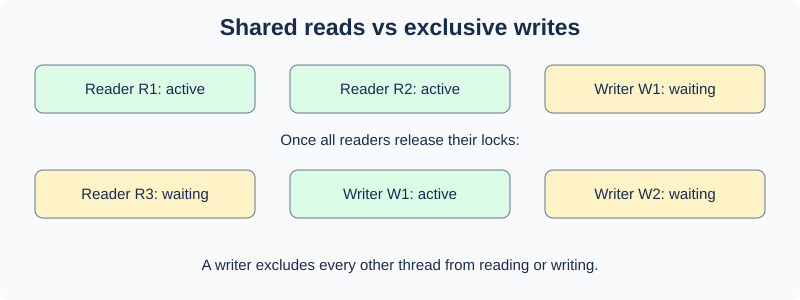
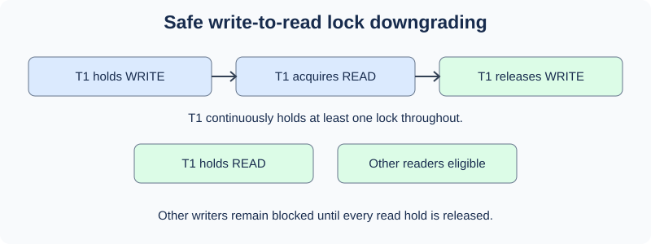

# Problem 4/45 — Reentrant Read-Write Lock

**Difficulty:** Very Hard | **Language:** Java 21 | **Target:** 45–60 minutes

## Problem statement

Implement a thread-safe reentrant read-write lock from scratch. Multiple threads should be able to read shared data concurrently, but a writer must have exclusive access against all other threads.

For example, a cache may serve thousands of reads while occasionally updating a value. An ordinary mutex serializes every read; a read-write lock permits independent readers to proceed together.



## API contract

```java
interface ReadWriteLock {
    void lockRead() throws InterruptedException;
    void unlockRead();
    void lockWrite() throws InterruptedException;
    void unlockWrite();
}
```

| Method | Expected behaviour |
| --- | --- |
| lockRead | Acquire a shared read hold or wait interruptibly. |
| unlockRead | Release one read hold owned by the calling thread. |
| lockWrite | Acquire an exclusive write hold or wait interruptibly. |
| unlockWrite | Release one write hold owned by the calling thread. |

Reject an unlock by a thread that does not own the corresponding lock with IllegalMonitorStateException.

## Requirements

- Multiple readers may hold read locks concurrently.
- Only one thread may hold the write lock.
- While a writer holds the lock, no other thread may acquire a read or write lock.
- Existing readers may reacquire the read lock; track holds per thread.
- The current writer may reacquire the write lock.
- The current writer may acquire a read lock to enable downgrading.
- Reject read-to-write upgrading by a reader that does not already own the write lock (IllegalStateException). Do not let it wait while retaining its read lock.
- Prefer waiting writers over new readers to avoid starvation caused by a continuous stream of new readers. Existing read holders and the current writer retain their reentrancy rights. This is writer preference, not strict FIFO fairness.

## Example 1 — Concurrent readers and a waiting writer

| Step | Operation | Active read holds | Writer | Result |
| --- | --- | --- | --- | --- |
| 1 | R1.lockRead() | 1 | None | Success |
| 2 | R2.lockRead() | 2 | None | Success |
| 3 | W1.lockWrite() | 2 | None | Wait |
| 4 | R3.lockRead() | 2 | None | Wait (writer preference) |
| 5 | R1.unlockRead() | 1 | None | Success |
| 6 | R2.unlockRead() | 0 | None | Success |
| 7 | W1 resumes | 0 | W1 | Success |
| 8 | W1.unlockWrite() | 0 | None | Success |
| 9 | R3 resumes | 1 | None | Success |

## Example 2 — Reentrancy

```java
// Same thread:
rw.lockWrite();
rw.lockWrite();
rw.unlockWrite(); // Still owns the write lock.
rw.unlockWrite(); // Exclusive ownership ends.
```

Similarly, two read acquisitions by the same thread require two matching releases.

## Example 3 — Safe lock downgrading



```java
rw.lockWrite();
try {
    // Update shared data.
    rw.lockRead();
} finally {
    rw.unlockWrite();
}
try {
    // Read the updated data without allowing another writer.
} finally {
    rw.unlockRead();
}
```

Assume there is exactly one write hold in this example. If there are multiple reentrant write holds, release all of them to complete the downgrade. Releasing the write lock before acquiring the read lock would introduce a gap in protection.

## Starter code

```java
import java.util.HashMap;
import java.util.Map;
import java.util.concurrent.locks.Condition;
import java.util.concurrent.locks.ReentrantLock;

class ReentrantReadWriteLockImpl implements ReadWriteLock {
    private final ReentrantLock lock = new ReentrantLock();
    private final Condition canRead = lock.newCondition();
    private final Condition canWrite = lock.newCondition();

    private final Map<Thread, Integer> readHolds = new HashMap<>();
    private int totalReadHolds;
    private Thread writer;
    private int writeHolds;
    private int waitingWriters;

    // TODO: implement the interface methods.
}
```

## Implementation hints

1. Implement a non-reentrant shared/exclusive lock first.
2. Protect all bookkeeping with the internal mutex.
3. Track read ownership and hold counts by thread, along with the total number of read holds.
4. Track the writer identity and its reentrant hold count.
5. Define separate predicates for read and write acquisition. Handle reentrancy before applying ordinary waiting rules.
6. Track waiting writers so new readers cannot continuously bypass them.
7. If a waiting writer is interrupted, repair the waiting-writer count and wake threads whose eligibility may have changed.
8. On unlock, validate ownership before changing state. Wake eligible readers or writers as appropriate.
9. Support downgrading without exposing an unlocked interval.

## Invariants

- totalReadHolds equals the sum of all per-thread read hold counts.
- All stored hold counts are positive; totals cannot be negative.
- writer is null exactly when writeHolds is zero.
- If a writer exists, any read holds belong only to that writer.
- waitingWriters cannot become negative.

## Constraints

- Do not use java.util.concurrent.locks.ReentrantReadWriteLock, StampedLock or AbstractQueuedSynchronizer.
- ReentrantLock, Condition and ordinary collections are allowed.
- No busy waiting or sleep-based synchronization.
- Handle spurious wakeups, interruption, invalid unlocks and concurrent callers.
- Avoid deadlock from lock upgrades.
- Writer preference is not a guarantee of starvation freedom for readers or strict fairness among writers.

## Test scenarios

- Two readers acquire concurrently.
- A writer waits for the last reader to release.
- Readers and other writers wait during exclusive ownership.
- Nested read and write acquisitions require matching unlocks.
- A non-owner cannot unlock.
- A waiting writer prevents new readers from barging.
- An existing reader may reacquire while a writer is waiting.
- Interrupt a waiting writer and verify eligible readers can resume.
- Verify safe downgrading and rejected read-to-write upgrades.
- Stress with multiple readers and writers; check that no writer overlaps another thread's read or write critical section.

## Advanced challenges

1. Add timed read and write acquisition using a shared timeout budget.
2. Implement strict FIFO admission with an explicit waiter queue and batching of consecutive reader requests.
3. Compare writer preference, reader preference and FIFO fairness.
4. Explain how to support an atomic upgrade safely, including why two simultaneous upgrades can deadlock.

Implement the basic shared/exclusive behaviour first, then ownership tracking, reentrancy, writer preference, interruption cleanup and downgrading. No solution code is provided.
