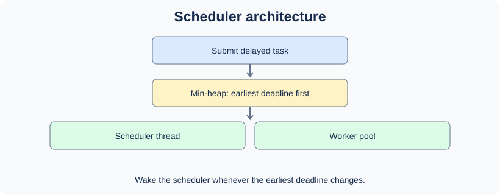
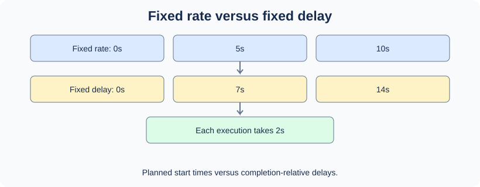

# Problem 9/45 — Scheduled Task Executor

**Difficulty:** Very Hard | **Language:** Java 21 | **Target:** 60–75 minutes

## Problem statement

Implement a scheduler that runs one-shot and periodic tasks using a deadline-ordered queue, a dedicated scheduler thread, and a separate worker pool.



## API contract

```java
interface TaskHandle {
    boolean cancel(boolean mayInterruptIfRunning);
    boolean isCancelled();
    boolean isDone();
}
interface MyScheduler {
    TaskHandle schedule(Runnable task, long delay, TimeUnit unit);
    TaskHandle scheduleAtFixedRate(Runnable task, long initialDelay,
                                   long period, TimeUnit unit);
    TaskHandle scheduleWithFixedDelay(Runnable task, long initialDelay,
                                      long delay, TimeUnit unit);
    void shutdown();
}
```

One-shot tasks become eligible after their delay, not necessarily execute at that exact instant. Nonpositive initial delays are immediate; periodic interval must be positive. Fixed-rate uses previous planned deadline plus period; fixed-delay uses completion time plus delay. Successive executions of the same periodic task must not overlap. A task exception suppresses future executions of that periodic task. For this exercise shutdown rejects new work, cancels undispatched tasks and future periodic runs, and lets already dispatched work finish. Cancellation is cooperative for running tasks.

## Example input and expected behaviour

Initial deadline 0, period/delay 5s, each run takes 2s. Fixed-rate starts at approximately 0, 5, 10s; fixed-delay at approximately 0, 7, 14s. If a fixed-rate run takes longer than its period, subsequent runs may start late but never overlap.



## Starter code

```java
class MyScheduledExecutor implements MyScheduler {
    private final ReentrantLock lock = new ReentrantLock();
    private final Condition changed = lock.newCondition();
    // TODO: priority queue ordered by deadline and sequence number,
    // scheduler thread, worker pool, task state and cancellation.
}
```

Import the required Java collections, concurrency utilities and locks. Starter code is intentionally incomplete.

## Implementation hints

1. Use System.nanoTime for relative deadlines and a monotonic sequence for ties.
2. Scheduler waits until the earliest deadline; wake it when an earlier task arrives.
3. Recheck the heap head after every wakeup.
4. Dispatch user code outside the scheduler lock to a worker pool.
5. Reschedule periodic work after completion, computing its next deadline by mode.
6. Make cancellation, dispatch and rescheduling state transitions atomic.
7. Handle worker rejection and shutdown explicitly; avoid silently stranding handles.

## Invariants

- Heap contains eligible pending scheduling records, or explicitly marked lazy-cancelled records.
- No periodic task has overlapping executions.
- Cancelled tasks cannot be rescheduled.
- No new schedule is accepted after shutdown.

## Constraints

- Implement the target component yourself; do not delegate to its equivalent JDK implementation.
- No busy waiting or sleep-based synchronization.
- Protect shared mutable state, handle spurious wakeups, and release locks in finally blocks.
- Define interruption and timeout behaviour explicitly; timed waits account for lock acquisition where applicable, but scheduling can delay return.
- Do not assume a particular OS thread execution order.

## Test scenarios

- One-shot task does not start before its deadline.
- An earlier inserted task wakes the scheduler.
- Equal deadlines use deterministic queue ordering, not guaranteed worker start ordering.
- Fixed-rate versus fixed-delay timing with a controlled clock or tolerant assertions.
- Long periodic task never overlaps itself.
- Cancellation before dispatch and during execution; exception stops recurrence.
- Shutdown wakes scheduler and cancels pending work.

## Advanced challenge

Add a fake clock/test hook, bounded dispatch backpressure, efficient cancellation removal, and persistence/recovery of scheduled jobs.

No solution code is supplied.
