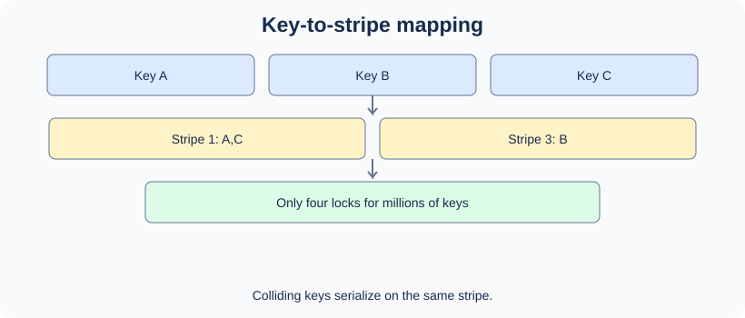
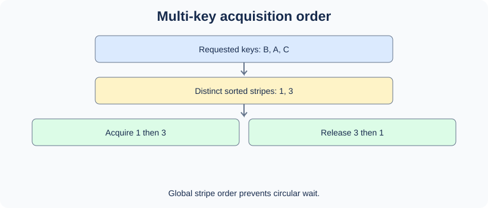

# Problem 14/45 — Striped Lock Manager

**Difficulty:** Hard | **Language:** Java 21 | **Target:** 35–45 minutes

## Problem statement

Implement key-based synchronization for millions of possible keys using a fixed number of reusable lock stripes. Equal keys must always map to the same stripe. Different keys may collide, reducing parallelism but preserving safety.



## API contract

```java
interface StripedLocks<K> {
    void withLock(K key, Runnable action) throws InterruptedException;
    void withLocks(Collection<K> keys, Runnable action)
        throws InterruptedException;
    boolean tryWithLocks(Collection<K> keys, Runnable action,
                         long timeout, TimeUnit unit)
        throws InterruptedException;
}
```

Use a fixed positive stripe count. Reject null keys/actions and null collections. Acquire every distinct stripe required by the keys in ascending stripe-ID order before running the action, then release in reverse order. On interruption or timeout, release any partially acquired locks and do not invoke the action. Empty key collections invoke the action without acquiring stripes. Timeout applies to acquisition, not callback duration. Keys must have stable hashCode/equals. Disallow nested calls that acquire new stripes out of order; either document non-reentrant usage or enforce an ordering policy.

## Example input and expected behaviour

With four stripes, assume A maps to 1, B maps to 3, C maps to 1. withLocks([B,A,C]) acquires stripe 1 then 3 exactly once each. Another caller requesting [C,B] uses the same order, avoiding circular wait.



## Starter code

```java
class StripedLockManager<K> implements StripedLocks<K> {
    private final ReentrantLock[] stripes;
    // TODO: constructor, stripe index calculation,
    // distinct sorted stripe selection and acquisition methods.
}
```

Import the necessary Java collections, concurrency classes and locks. Starter code is intentionally incomplete.

## Implementation hints

1. Preallocate locks rather than allocating a lock for each key.
2. Use Math.floorMod(hash, stripeCount) or a safe power-of-two mask; avoid Math.abs(Integer.MIN_VALUE).
3. Deduplicate stripe IDs, not just keys.
4. Sort stripe IDs before acquiring locks.
5. Track acquired locks and release in reverse order in finally.
6. For timed multi-lock acquisition, share a single monotonic timeout budget.
7. Never assume different keys imply independent locks.

## Invariants

- Equal stable keys map to the same lock.
- A callback runs only when all required stripes are held.
- Each acquired stripe is released exactly once by the operation.
- All non-nested multi-lock operations acquire stripes in one global order.

## Constraints

- Implement the target component yourself; do not delegate to an equivalent library implementation.
- No busy waiting or sleep-based synchronization.
- Protect shared mutable state, handle spurious wakeups where applicable, and release acquired locks in finally blocks.
- Do not assume OS thread execution order.
- Account for elapsed time with a monotonic clock when implementing timed acquisition.

## Test scenarios

- Same-key callbacks cannot overlap.
- Different-stripe callbacks can overlap.
- Hash collisions remain safe.
- Duplicate keys and duplicate stripe IDs do not leak holds.
- Opposite key ordering does not cause deadlock.
- Timeout/interruption during partial acquisition releases earlier stripes.
- Negative and minimum integer hash codes.

## Advanced challenge

Design dynamic stripe resizing without allowing old and new lock mappings to protect the same key concurrently. Compare a global migration barrier, versioned stripe tables and fixed-size stripes.

No solution code is supplied.
