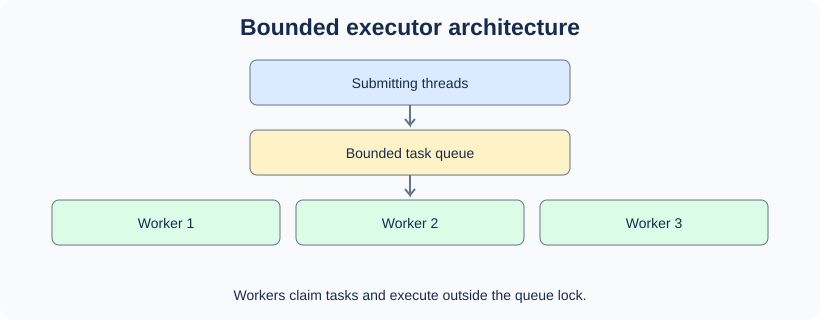
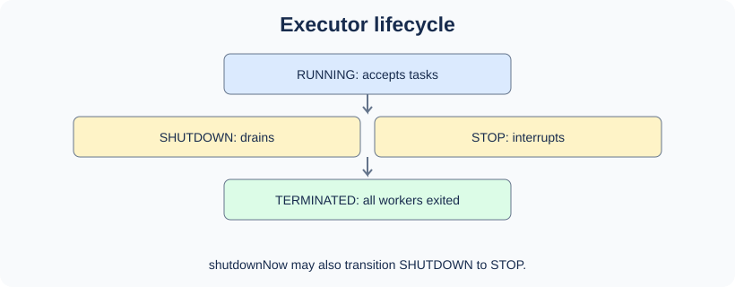

# Problem 7/45 — Thread Pool Executor

**Difficulty:** Very Hard | **Language:** Java 21 | **Target:** 60–75 minutes

## Problem statement

Implement a bounded fixed-size thread pool from scratch. Reuse worker threads, queue submitted tasks, reject overload, and support graceful and immediate shutdown.



## API contract

```java
interface MyExecutor {
    void execute(Runnable task);
    void shutdown();
    List<Runnable> shutdownNow();
    boolean isShutdown();
    boolean isTerminated();
    boolean awaitTermination(long timeout, TimeUnit unit)
        throws InterruptedException;
}
```

Start with a fixed positive worker count and bounded positive queue capacity. execute rejects null tasks and rejects when full or not running using RejectedExecutionException. shutdown stops acceptance but drains accepted tasks. shutdownNow stops acceptance, removes queued tasks and returns them, and requests interruption of workers; already claimed tasks may run or respond to interruption cooperatively. awaitTermination returns true only after all workers exit. Task failures must not silently reduce capacity while running.

## Example input and expected behaviour

Two workers, queue capacity two. A and B are running; C and D are queued; E is rejected while both workers and queue are occupied. shutdown drains C and D before termination.



## Starter code

```java
class MyThreadPool implements MyExecutor {
    enum State { RUNNING, SHUTDOWN, STOP, TERMINATED }
    private final ReentrantLock lock = new ReentrantLock();
    private final Condition workAvailable = lock.newCondition();
    private final Condition terminated = lock.newCondition();
    private final Deque<Runnable> tasks = new ArrayDeque<>();
    private final List<Thread> workers = new ArrayList<>();
    // TODO: capacity, state, live worker count, worker loop and methods.
}
```

Import the required Java collections, concurrency utilities and locks. Starter code is intentionally incomplete.

## Implementation hints

1. Implement a worker loop that waits when the queue is empty.
2. Make task acceptance and lifecycle transitions atomic.
3. Never execute user tasks while holding the internal lock.
4. Distinguish graceful draining from immediate stop.
5. Track worker exits and signal termination when the final worker exits.
6. Handle unchecked task failures, interruption and rejection without losing accepted tasks unintentionally.

## Invariants

- Queue size never exceeds capacity.
- No new task is accepted after shutdown linearizes.
- TERMINATED implies no live workers.
- Each accepted task is claimed at most once; queued tasks returned by shutdownNow are not claimed.

## Constraints

- Implement the target component yourself; do not delegate to its equivalent JDK implementation.
- No busy waiting or sleep-based synchronization.
- Protect shared mutable state, handle spurious wakeups, and release locks in finally blocks.
- Define interruption and timeout behaviour explicitly; timed waits account for lock acquisition where applicable, but scheduling can delay return.
- Do not assume a particular OS thread execution order.

## Test scenarios

- Maximum active tasks does not exceed worker count.
- Queue-full rejection with blocked workers.
- Workers reuse threads and survive task failure.
- Graceful shutdown drains all accepted tasks.
- Immediate shutdown returns queued tasks and interrupts workers.
- Concurrent submit/shutdown and bounded awaitTermination.

## Advanced challenge

Add dynamic worker scaling, keep-alive expiry, rejection strategies and a Future-returning submit API. Compare deadlock risks when workers submit and wait on child tasks.

No solution code is supplied.
